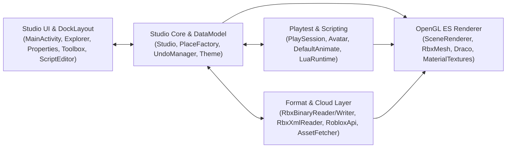

&lt;div align=&quot;center&quot;&gt;

# StudioRblx

**A native Android 3D Roblox-compatible Studio editor & playtest engine.**  
Build, inspect, script, import `.rbxl` / `.rbxlx` / `.rbxm` worlds, and playtest with official Roblox R15/R6 animations — directly on Android.

&lt;p&gt;
  &lt;img src=&quot;https://img.shields.io/badge/Platform-Android%207.0%2B%20(API%2024--35)-3DDC84?style=for-the-badge&amp;logo=android&amp;logoColor=white&quot; alt=&quot;Android 7.0+&quot;/&gt;
  &lt;img src=&quot;https://www.google.com/search?q=https://img.shields.io/badge/Package-com.goydevv.studrblx-00A2FF%3Fstyle%3Dfor-the-badge&quot; alt=&quot;Package&quot;/&gt;
  &lt;img src=&quot;https://img.shields.io/badge/Graphics-OpenGL%20ES%202.0%2F3.0-5586A4?style=for-the-badge&amp;logo=opengl&amp;logoColor=white&quot; alt=&quot;OpenGL ES&quot;/&gt;
  &lt;img src=&quot;https://img.shields.io/badge/JDK-17-ED8B00?style=for-the-badge&amp;logo=openjdk&amp;logoColor=white&quot; alt=&quot;JDK 17&quot;/&gt;
  &lt;img src=&quot;https://img.shields.io/badge/CI-GitHub%20Actions-2088FF?style=for-the-badge&amp;logo=githubactions&amp;logoColor=white&quot; alt=&quot;GitHub Actions&quot;/&gt;
&lt;/p&gt;

&lt;p&gt;
  &lt;a href=&quot;#-highlights&quot;&gt;Highlights&lt;/a&gt; •
  &lt;a href=&quot;#-feature-matrix&quot;&gt;Feature Matrix&lt;/a&gt; •
  &lt;a href=&quot;#-architecture&quot;&gt;Architecture&lt;/a&gt; •
  &lt;a href=&quot;#-building-locally&quot;&gt;Build Locally&lt;/a&gt; •
  &lt;a href=&quot;#-github-actions-signed-apk&quot;&gt;CI / Signed APK&lt;/a&gt; •
  &lt;a href=&quot;#-crash-reporting&quot;&gt;Crash Reporting&lt;/a&gt;
&lt;/p&gt;

&lt;/div&gt;

---

## ✨ Highlights

- **Next-Gen Dark Studio Workspace**: Landscape-locked dockable editor (`Explorer`, `Properties`, `Toolbox`, `Output`, `Script Editor` with Lua autocomplete, `Avatar` & `Audio` browsers) built around a high-contrast dark palette (`#17191E` / `#1E2025` / `#00A2FF`).
- **Real `.rbxl` / `.rbxlx` / `.rbxm` Support**: Full binary (ZSTD & LZ4 chunk decompression, Type-34 `Content`, `SSTR`, `INST`, `PROP`, `PRNT`) and XML serialization/deserialization, plus Roblox Cloud place browsing, downloading, version history, and publishing.
- **Direct Roblox CDN Asset Pipeline**: Fetches Baseplate textures (`rbxassetid://6372755229`), SpawnLocation decals (`rbxassetid://12224170`), R15/R6 `KeyframeSequence` clips, clothing, and meshes directly from Roblox AssetDelivery (`v2`/`v1`) with `thumbnails.roblox.com` CDN fallback.
- **Roblox-Parity Lighting, Atmosphere & Sky**: Honors `ClockTime`, `GeographicLatitude`, `Ambient`, `OutdoorAmbient` (`>= Ambient` clamping when `GlobalShadows` is enabled), `ColorShift_Top`, `Brightness`, `EnvironmentDiffuseScale`, `ExposureCompensation`, and `Atmosphere` (`Density`, `Offset`, `Color`, `Decay`, `Haze`) with shadow mapping, ACES Filmic tone mapping, and a midnight navy sky with twinkling stars and moon.
- **Native Mobile Playtest Engine**: Embedded LuaJ runtime (`Script` / `LocalScript` / `ModuleScript`), pre-warmed official R15 & R6 `Animate` state machine (`idle`, `walk`/`run` weight blending, `jump`, `fall`, `climb`, `sit`, `toolnone`, emotes), first-person character/face hiding, and Roblox-parity `DynamicThumbstick`, `TouchJump`, Shift Lock, Chat, Health, and TopBar HUD.
- **Built-in Crash Screen & `.txt` Log Exporter**: Captures fatal crashes across all threads (including GL/background threads), persists a full report (device info, stack trace, recent Studio Output, and `logcat` tail), and lets you export a `.txt` log file via Android Storage Access Framework in one tap.

---

## 📊 Feature Matrix

| Subsystem | Capabilities | Key Classes |
| :--- | :--- | :--- |
| **3D Renderer & Lighting** | Shadow maps, ACES Filmic blend, `Lighting` + `Atmosphere` + `Sky`, decals, `SurfaceGui`, `MeshPart`, `SpecialMesh`, `UnionOperation`, Draco meshes | `SceneRenderer`, `RbxMesh`, `Draco`, `StaticBatches`, `MaterialTextures` |
| **File & Cloud I/O** | Binary `.rbxl`/`.rbxm` (ZSTD + LZ4), XML `.rbxlx`/`.rbxmx`, Open Cloud + Cookie AssetDelivery `v2`/`v1`, place publish & version history | `RbxBinaryReader`, `RbxBinaryWriter`, `RbxXmlReader`, `RobloxApi`, `RobloxCloud` |
| **Asset & Texture CDN** | Direct `assetdelivery.roblox.com` + `thumbnails.roblox.com` fallback, disk + LRU bitmap cache, `rbxasset://` official ID resolution | `AssetFetcher`, `ImageLoader`, `MeshLoader`, `UnionMeshes` |
| **Playtest & Physics** | Humanoid controller, R15/R6 rigs, pre-warmed official Roblox `KeyframeSequence` playback, `BodyVelocity`/movers, proximity prompts, tools | `PlaySession`, `Avatar`, `DefaultAnimate`, `AnimLibrary`, `AnimPlayer` |
| **Scripting Runtime** | LuaJ execution for `Script`, `LocalScript`, `ModuleScript`, Roblox Services & Instance API, plugin loader | `LuaRuntime`, `InstanceApi`, `RobloxServices`, `PluginManager` |
| **Studio UI & Diagnostics** | Dockable split panels, ribbon toolbar, script editor with autocomplete, `PlayHud`, `DynamicThumbstick`, `CrashActivity` `.txt` export | `MainActivity`, `DockLayout`, `ViewportView`, `PlayHud`, `Theme`, `CrashActivity` |

---

## 🏗️ Architecture



&lt;details&gt;
&lt;summary&gt;&lt;b&gt;📁 Project Structure (Click to expand)&lt;/b&gt;&lt;/summary&gt;

```text
MobileStudio/
├── .github/workflows/
│   └── build-debug.yml          # Automated signed debug APK build workflow
└── app/
    ├── build.gradle.kts         # Android SDK 35, minSdk 24, JDK 17, zstd-jni, LuaJ
    └── src/main/
        ├── AndroidManifest.xml  # Landscape lock, .rbxl/.rbxm intent filters, CrashActivity
        ├── assets/              # Bundled Studio fonts & UI assets
        └── java/com/goydevv/studrblx/
            ├── MainActivity.java
            ├── StudioApp.java
            ├── CrashActivity.java
            ├── core/            # Studio, PlaceFactory, Settings, Theme, OutputLog, UndoManager
            ├── engine/          # PlaySession, Avatar, DefaultAnimate, AnimLibrary, Geometry, Csg
            ├── format/          # RbxBinaryReader, RbxBinaryWriter, RbxXmlReader, Lz4, CsgMesh
            ├── lua/             # LuaRuntime, InstanceApi, RobloxServices, PluginApi
            ├── model/           # DataModel, Instance, PartData, CFrame, Vector3, Color3
            ├── net/             # RobloxApi, RobloxCloud, AssetFetcher, ImageLoader, Http
            ├── render/          # SceneRenderer, RbxMesh, Draco, StaticBatches, FlyCamera
            └── ui/              # DockLayout, ViewportView, PlayHud, ExplorerPanel, PropertiesPanel, ScriptEditor
```

&lt;/details&gt;

---

## 🎮 Controls

| Mode | Action | Input |
| :--- | :--- | :--- |
| **Edit Mode** | Move camera | Left thumbstick (WASD on hardware keyboard) |
| **Edit Mode** | Look / Orbit | Drag anywhere on viewport |
| **Edit Mode** | Fly Up / Down | Right-side Up / Down buttons (E / Q) |
| **Edit Mode** | Select / Transform | Tap part + Move / Scale / Rotate gizmos |
| **Playtest** | Walk / Run | Roblox `DynamicThumbstick` or fixed `Thumbstick` |
| **Playtest** | Jump | Bottom-right `TouchJump` button (Space) |
| **Playtest** | Shift Lock | Lock toggle beside Jump button |
| **Playtest** | Chat / Menu / Players | TopBar CoreGui buttons |

---

## 🛠️ Building Locally

### Prerequisites
- **JDK 17** (`java -version` → 17.x)
- **Android SDK** with `compileSdk = 35` and `build-tools` installed (works on desktop Android Studio and on-device ARM64 Linux/Termux/ArseIDE setups)

### Build Commands

```bash
# Clean and build debug APK
./gradlew clean assembleDebug --build-cache

# Output APK location
# app/build/outputs/apk/debug/app-debug.apk
```

---

## 🚀 GitHub Actions (Signed APK)

This repository includes `.github/workflows/build-debug.yml`, which compiles and signs the debug APK with your own Android keystore.

Add the following **Repository Secrets** under **Settings → Secrets and variables → Actions**:

| Secret Name | Description |
| :--- | :--- |
| `SIGNING_KEYSTORE_BASE64` | Base64-encoded `.jks` or `.keystore` file (`base64 -w 0 my-key.jks`) |
| `SIGNING_KEYSTORE_PASSWORD` | Keystore password |
| `SIGNING_KEY_ALIAS` | Key alias inside the keystore |
| `SIGNING_KEY_PASSWORD` | Key password for the alias |

Every push or manual `workflow_dispatch` uploads the signed APK directly to the workflow run's **Artifacts** tab.

---

## 🐞 Crash Reporting

If an unhandled exception occurs on any thread:

1. **StudioRblx Crash Report** opens automatically (or on the next app launch if background activity starts are restricted by the OS).
2. Tap **Export .txt** to save a complete `.txt` report containing device metadata, stack trace, recent Studio Output, and `logcat` warnings anywhere on your device.
3. Crash reports are also auto-saved to:
   ```text
   /Android/data/com.goydevv.studrblx/files/crash_logs/StudioRblx_crash_<timestamp>.txt
   ```
4. Attach the exported `.txt` file when opening an issue.

---

## ⚠️ Disclaimer

StudioRblx is an independent mobile editor and runtime project and is **not** affiliated with, endorsed by, or sponsored by Roblox Corporation. All Roblox trademarks, file formats, and assets fetched from Roblox services belong to their respective owners.

---

&lt;div align=&quot;center&quot;&gt;
  &lt;sub&gt;Built by &lt;b&gt;GoyDevv&lt;/b&gt; • Package &lt;code&gt;com.goydevv.studrblx&lt;/code&gt;&lt;/sub&gt;
&lt;/div&gt;